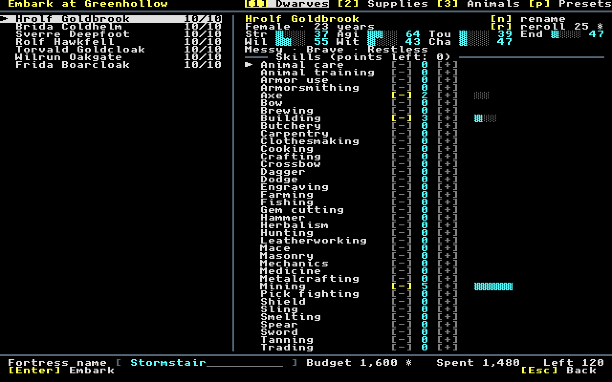
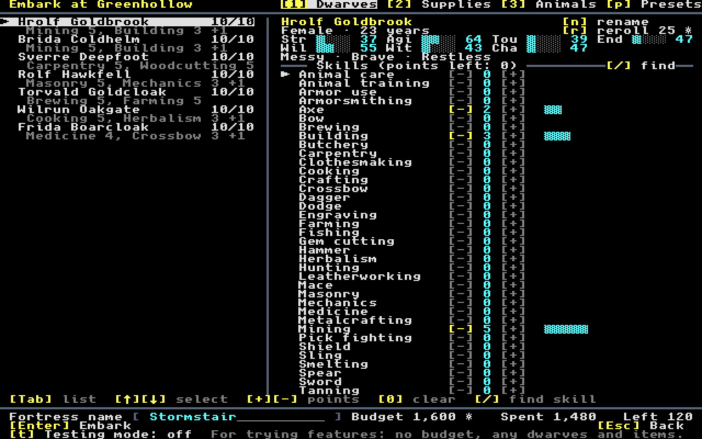
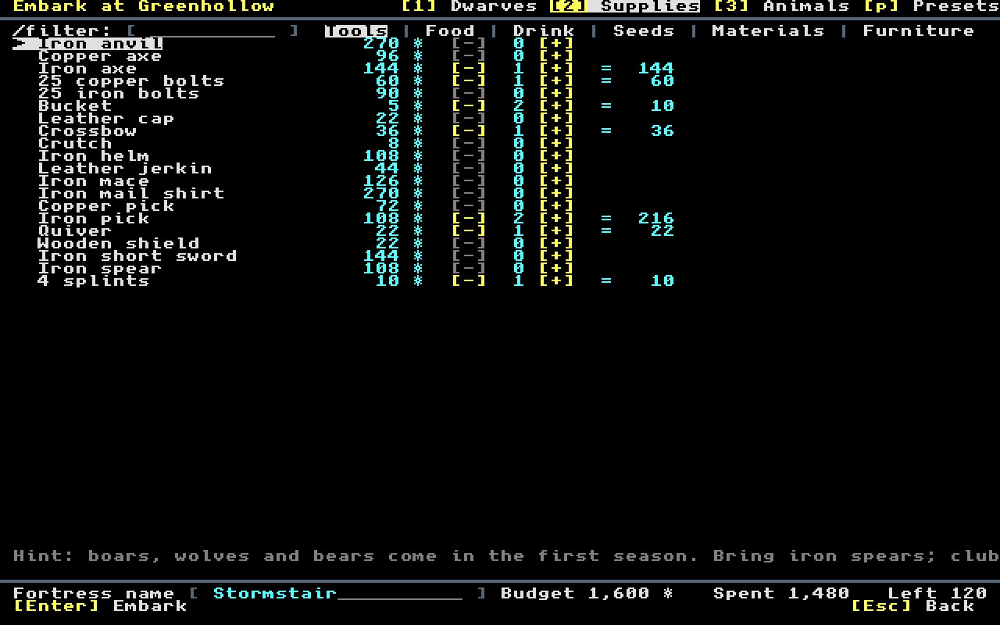
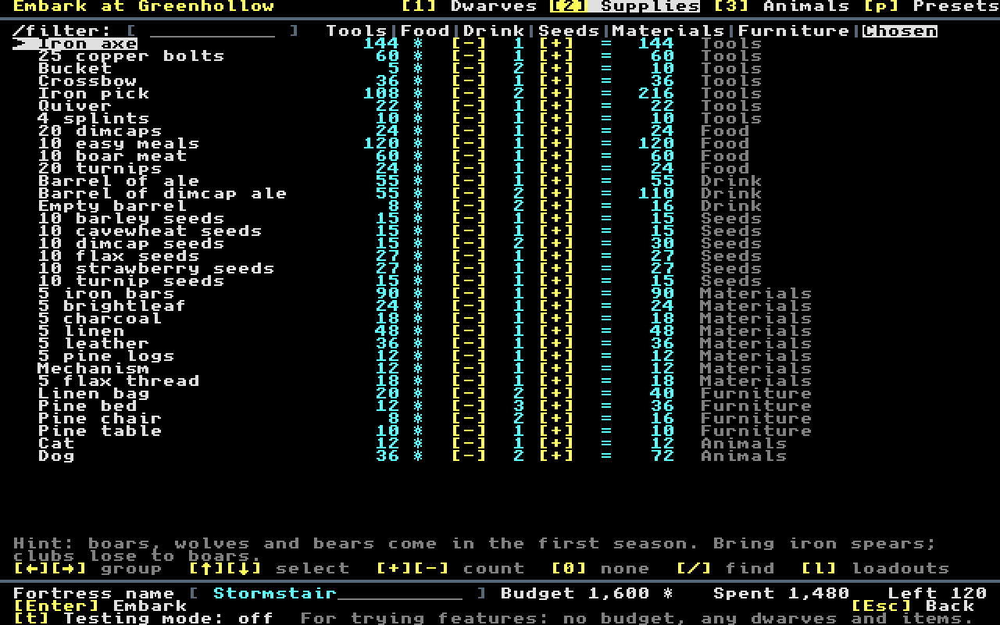
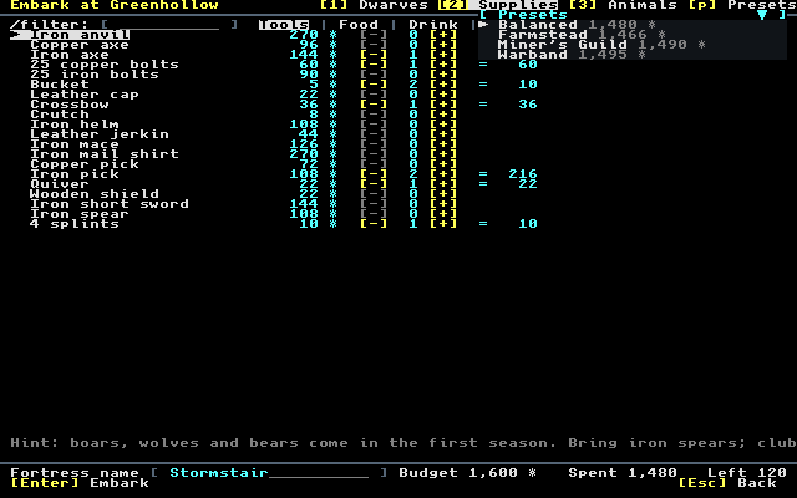
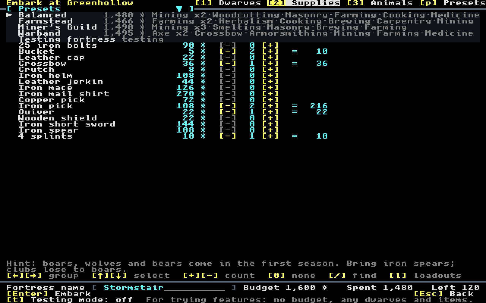
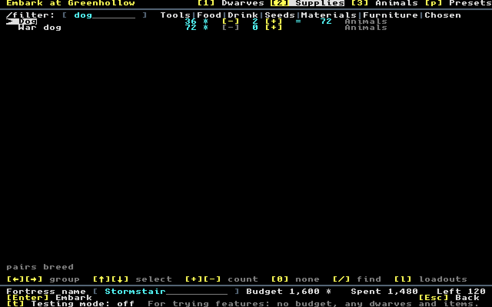

# Audit: the starting loadout screen, used as a new player would

**Task:** T-533 · **Date:** 2026-11-09 · **Commits examined:** master after T-531 (`ff018a46`), and the T-533 branch · **Kind:** a UI and UX pass, with the fixes · **Source:** [the T-533 work file](../../docs/archive/tasks/T-533-loadout-ui-pass.md), [the embark wireframe](../../docs/04-implementation/ui-screens/embark.md)

## The answer

- **Before, the screen was usable with the mouse and slow with the keyboard.** A typical change to the Balanced start (two skill swaps, three supplies dropped, four added, two animal changes) took **25 clicks** or **137 keys**, 100 of them arrow presses through the alphabetical list of 42 skills.
- **Finding a skill was the worst part.** Woodcutting, last in the list, took **42 keys** to select, and at 80 × 50 cells the last four skills (Unarmed down to Woodcutting) were **out of reach of the mouse**: the list had no wheel and no scrollbar.
- **Finding a supply was easier, but the find field missed animals** ("war dog" found nothing), and there was no single view of what the wagon held: reviewing the loadout meant visiting **7 views** (6 groups and Animals).
- **Fixed, plainest first:** a find on every list, `0` to clear, a Chosen view, the mouse wheel and `PageUp` `PageDown`, each dwarf's skills in the party list, a keys line, a reason when a key does nothing, the presets described, unspent points named, and a question before `Esc` throws the edits away.
- **After:** the same loadout takes **88 keystrokes** (51 keys and 37 typed letters; 43 of them on the Dwarves tab, down from 100), the mouse path stays at **25 clicks** with every skill now reachable, Woodcutting takes **6 keystrokes**, a war dog **5**, and the whole loadout is reviewed in **1 view**.

## How it was measured

The screen was driven headlessly at 80 × 50 cells (the 1280 × 800 window), with the real `EmbarkScreen`, keymap and strings, counting each key press, typed letter and click; the pictures are its cells drawn with the bundled font, as `npm run screenshot` draws a save (the screenshot tool itself starts from a save, so it cannot reach the embark screen). The keyboard paths are those of a player who knows the keys and presses arrows until the row is selected; the mouse path clicks each row's `[-]` or `[+]`. The new e2e `embark-find` plays the new paths in the browser.

The typical loadout, from Balanced on a peril 1 site (budget 1,600): the seventh dwarf trades Crossbow 3 for Spear 3; the second trades Axe 2 for Dodge 2; drop the crossbow, the copper bolts and the quiver; add an iron spear, 5 cheese and a barrel of ale; one dog fewer, one goat; embark. It ends at Spent 1,549 both before and after.

## Frictions found, and what changed

| # | Friction (before) | Count before | Change | Count after |
|---|---|---|---|---|
| 1 | Skills are one alphabetical list of 42; the only way to a skill is arrows | Woodcutting: 42 keys to select | `/` on Dwarves finds a skill by name; `PageUp` `PageDown` move a page | 2 keys + 4 letters |
| 2 | At 80 × 50 the last four skills cannot be reached by mouse | 38 of 42 reachable | The wheel scrolls every embark list | 42 of 42 |
| 3 | `+` on a dwarf with no points left, or at a maximum, does nothing and says nothing | silent | The keys line says why ("No skill points left for Frida Boarcloak: lower another skill first.") | — |
| 4 | Lowering a skill or line to nothing takes one press per level (Mining 5: 5 presses) | 5 | `0` clears the selected skill or line | 1 |
| 5 | The party list shows names and points only: who mines? | 7 clicks to see the party's trades | Each dwarf has a second line with its skills ("Masonry 5, Mechanics 3 +1") | 0 |
| 6 | The supplies find misses animals and group names | "war dog": not found; 10 keys by arrows on Animals | The find covers every entry and group names, lines name their group; `/` on Animals goes to it | 2 keys + 3 letters |
| 7 | No view of the whole loadout | 7 views | Chosen, the bar's last view: every chosen line, supplies and animals, group by group | 1 view |
| 8 | A find's text stays until erased letter by letter; a category click does not end it | 1 + n Backspaces | `/` starts a new find; `Esc` empties it; choosing a group ends it | 1 |
| 9 | No key is explained on the screen except the header and footer buttons (`Tab` between lists, `/`, `←` `→` groups) | — | A keys line at the foot of each tab | — |
| 10 | The presets menu shows names and totals only, though the wireframe promised a description; it opens on the first preset | — | Each preset names its dwarves' main skills ("Mining x2·Woodcutting·Masonry·Farming·Cooking·Medicine"); the menu opens on the current preset | — |
| 11 | Unspent skill points are lost at embark, and the screen does not warn (02 says it does) | — | The footer names the dwarves with points left | — |
| 12 | Over budget, the footer reads "Left -250" and runs into the fortress name field at 80 columns | overlap | "Over 250" in red; the figures close up rather than overlap or clip | — |
| 13 | The second hint is cut at 80 columns ("…Bring iron spears; club»") | cut | The hint wraps to two lines | — |
| 14 | `Esc` (or Back) throws away every edit at once, with no question | 1 key loses the loadout | After edits it asks `c_leave_embark`, default No | — |

## The typical loadout

| Path | Before | After |
|---|---|---|
| Keyboard, all | 137 keys | 51 keys + 37 typed letters = 88 |
| Keyboard, Dwarves tab | 100 keys | 27 keys + 16 typed letters = 43 |
| Mouse | 25 clicks | 25 clicks |

The mouse path does not get shorter: it was already one click per step, because every row has its `[-]` and `[+]`. What the mouse gains is reach (every skill), the Chosen view and the party's trades at a glance. Most of the keyboard saving is on the Dwarves tab, where the find replaces long arrow runs; on Supplies the Chosen view and `0` make dropping lines quick, and the find takes typing instead of switching groups.

## Pictures

Before (master at `ff018a46`) and after, at 80 × 50 cells:

| | Before | After |
|---|---|---|
| Dwarves |  |  |
| Supplies |  (Tools) |  (Chosen) |
| Presets menu |  |  |
| Find "dog" | (finds nothing) |  |

## With testing mode (T-532)

T-532 landed during this pass: a `[t] Testing mode` line, party keys `a` and `x`, `*` for a skill on every dwarf, an Items tab (`4`) and a "Testing fortress" preset. The two fit together this way:

- **One find, `/`, on every tab.** Dwarves finds a skill (every skill in testing mode), Supplies and Animals find any supply or animal, Items narrows the selected field's choices; `/` always starts a fresh find, and `Esc` always empties a find before it would leave the screen.
- **`0` clears on every tab**: a skill, a supply or animal line, and on Items the selected line (as `x`). `*` applies to the skill the find selected.
- **The keys line follows the mode**: in testing mode the Dwarves line reads `[Tab] list  [+][-] level  [0] clear  [*] to every dwarf  [/] find skill`, and the `[a] add dwarf  [x] remove` row sits above it. The skills rule became "Skills (testing: up to 20)", so the `[/] find` caption fits beside it.
- **80 columns**: the testing switch's two notes were cut at 80 columns; they now read "For trying features: no budget, any dwarves and items." and "No budget or limits. The fortress is marked as testing.", whole. Testing mode names no unspent points. Only the testing title still gives way to the four tabs, by T-532's design.

The counts above are for normal play and are the same after the merge; the after pictures are of the merged screen.

## Left as it is

- **`Enter` embarks from any list**, not only from the footer, as the keymap's "`Enter` on the footer" suggests; a player who presses `Enter` to "choose" a row embarks. The question before an embark without a pick, an axe, food or drink catches the worst case; changing the key would change every embark path, so it is left for a decision.
- **Typing a number for a quantity** is not offered: the digits `1` `2` `3` are the tab keys, and no entry allows more than 10, so `+` `-` and `0` are enough.
- **Categories that collapse** were not added: the groups are short (4 to 20 lines), each fits the list at 80 × 50, and the Chosen view and the find cover what collapsing would give.
